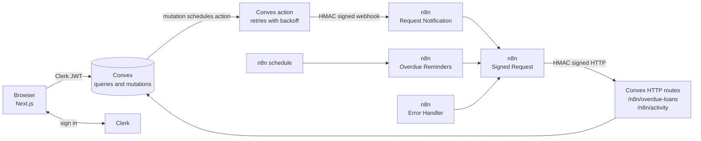
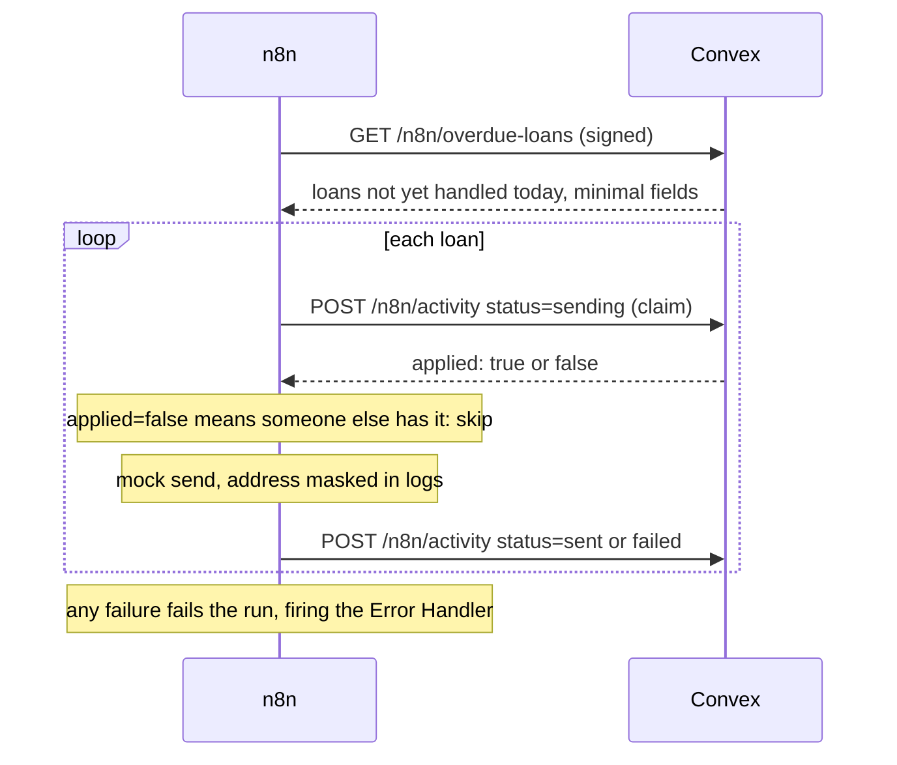

# LendLoop

**Borrow what you need. Lend what you don't.**

A neighborhood tool-lending board. Neighbors list tools, request to borrow them and approve or decline requests, while n8n handles notifications and overdue reminders.

Stack: Next.js (App Router), TypeScript, Clerk, Convex, n8n (Docker), Tailwind and shadcn/ui.

## 5-minute quickstart

You need Node 22.18+, Docker and a free Clerk account. No Convex account is needed: Convex runs locally.

**1. Install and create secrets**

```bash
npm install
npm run env:init          # creates .env with random secrets
cp .env.local.example .env.local
```

**2. Set up Clerk**

1. Create an application at [dashboard.clerk.com](https://dashboard.clerk.com).
2. Copy its publishable and secret keys into `.env.local`.
3. Under **JWT templates**, create one from the **Convex** preset. It must be named `convex`.
4. Copy the template's **Issuer** URL into `CLERK_JWT_ISSUER_DOMAIN` in `.env`.

**3. Start Convex** (terminal 1, keep it running)

```bash
npx convex dev
```

Choose **Start without an account (run Convex locally)**.

The first push fails with `CLERK_JWT_ISSUER_DOMAIN ... was not set`. That is expected, and the next step fixes it.

**4. Configure and seed Convex** (terminal 2)

```bash
npm run convex:env        # copies only the variables Convex needs from .env
npx convex run seed:run   # run once terminal 1 prints "Convex functions ready"
```

**5. Start n8n and load the workflows**

```bash
docker compose up -d
npm run n8n:import        # loads credentials and workflows, then publishes them
```

Open <http://localhost:5678> and create your local n8n owner account.

**6. Start the app, sign in and become admin**

```bash
npm run dev               # http://localhost:3000
```

Sign in once, then promote yourself:

```bash
npx convex run users:promoteToAdmin '{"email":"you@example.com"}'
```

## Running the app in Docker

After steps 1 to 5, you can run the app in a container instead of `npm run dev`:

```bash
npm run docker:app        # builds the image and serves http://localhost:3000
```

Stop it with `docker compose --profile app down`. That leaves the `n8n_data` volume alone, but it also stops n8n, so start n8n again with `docker compose up -d`.

Only the Next.js app runs in this container. Convex stays on `npx convex dev`, because its CLI has to push the functions, and the browser reaches it at `NEXT_PUBLIC_CONVEX_URL`. The image is built for that one URL and Clerk key, so rebuild it if either changes.

`CLERK_SECRET_KEY` is passed at runtime and is not stored in the image. `.dockerignore` keeps every `.env` file out of the build.

## Testing the workflows

The **Admin > Automation** page updates live while you run these.

| What to prove | Command or action | Expected result |
|---|---|---|
| Request notification | Request a tool, then approve it, from two accounts | A "Notification sent" line on the loan |
| Overdue reminders | `npm run n8n:overdue` | Bob's reminder is `sent`; Dana's is `failed` (a simulated bounce) |
| Error workflow | The same run | A `workflow_error` row for the failed run |
| Idempotent re-run | `npm run n8n:overdue` again | Only Dana's loan is processed; Bob is not reminded twice |
| Forged signature | `npm run n8n:webhook -- forged` | HTTP 401 and a `workflow_error` row |
| Stale timestamp | `npm run n8n:webhook -- stale` | HTTP 401 |
| Exact-bytes check | `npm run n8n:webhook -- reserialized` | HTTP 401, because it is the same JSON in different bytes |
| Tampered body | `npm run n8n:webhook -- tampered` | HTTP 401 |
| Replay inside the window | `npm run n8n:webhook -- replay` | Two 202s, one `mock-notification` in `docker compose logs n8n` |
| n8n outage | `docker compose stop n8n`, request a tool, `docker compose start n8n` | The request succeeds at once; Convex retries and the event ends `sent` |

Unit and integration tests, and the check to run before committing:

```bash
npm test                  # RBAC, HMAC, dates, idempotency, HTTP endpoints
npm run check:secrets     # no secret value in any tracked file; exports hold credential references only
```

n8n does not fire the Error Workflow for runs started with the editor's Execute button. `npm run n8n:overdue` runs through the CLI, which does.

## Architecture



The overdue flow, which shows the claim that makes retries safe:



### Where things are

| Path | Purpose |
|---|---|
| `convex/lib/auth.ts` | `requireUser`, `requireAdmin` and the pure permission rules |
| `convex/lib/hmac.ts` | Sign and verify, used for both directions |
| `convex/lib/automationState.ts` | The idempotency rule, as a small pure function |
| `convex/notifications.ts` | Outbound webhook: payload, signing, retries |
| `convex/automation.ts` | The ledger and the overdue query |
| `convex/http.ts` | Signed inbound routes |
| `n8n/workflows/` | Workflow JSON. Credential references only |
| `app/`, `components/` | The UI |

## Security decisions

### Identity and roles

Every public Convex function begins with `requireUser` or `requireAdmin`, which read identity from `ctx.auth`, the verified Clerk JWT. No function accepts a user ID for "who is acting". `listPublic` is the one exception, and it returns an explicit allow-list of `_id`, `name` and `category`, which a test asserts.

The UI hides admin links as a convenience. Calling a Convex function directly gets the same answer.

| Action | User | Admin |
|---|---|---|
| Create a listing | Yes | Yes |
| Edit a listing | Own only | Own only |
| Remove a listing | Own, with no approved loans | Any |
| Approve, decline, mark returned | Own tools only | Own tools only |
| Cancel a request | Own requests only | Own requests only |
| View all loans and users, grant Trusted Lender | No | Yes |

Admins moderate but do not act on other people's loans. Only the lender marks a return, because they are the one who gets the tool back.

**Promoting the first admin:** `users:promoteToAdmin` is an internal function, so browsers cannot call it (the public API answers "Could not find public function"). Running it needs deployment access, and signing in again never changes a role.

### HMAC signing

```
signature = hex( HMAC-SHA256( secret, "<unix seconds>." + <raw body bytes> ) )
headers:    x-lendloop-timestamp, x-lendloop-signature
```

| Property | How |
|---|---|
| Authenticity and integrity | HMAC-SHA256 over the raw bytes |
| Constant-time compare | `crypto.subtle.verify` in Convex; `crypto.timingSafeEqual` in n8n |
| Replay protection | The timestamp is inside the signed bytes and must be within 5 minutes |
| Replay inside the window | Handled by idempotency: a repeat loses the claim and sends nothing |
| Exact bytes | The n8n webhook uses Raw Body; Convex reads `arrayBuffer()` and verifies before parsing |
| One secret per direction | A leak in one direction cannot forge the other, and a message cannot be reflected back |

### Where n8n keeps its secret, and why

This was checked against n8n 2.45.7, the pinned version. There were two options:

| | Crypto node + n8n credential (chosen) | Container env var + `$env` |
|---|---|---|
| Secret in exported JSON | Never, only a credential reference | Never, only an expression |
| Encrypted at rest | Yes, with `N8N_ENCRYPTION_KEY` | No, it is plain container config |
| Who can read it | The Crypto node | Any expression in any workflow |
| Side effect | None; env access stays blocked | Must disable the block, which also exposes `N8N_ENCRYPTION_KEY` to expressions |

The Crypto node cannot compare in constant time, so verification takes two steps. The Crypto node computes the expected digest using the credential, then a Code node compares digests with `timingSafeEqual`. The Code node never has the secret, and `NODE_FUNCTION_ALLOW_BUILTIN=crypto` allows only that one module.

A trade-off: anyone with editor access to n8n could wire a node to compute HMACs with that credential, even though they cannot read it. So the n8n editor is a trusted surface, and it is bound to localhost here.

Secrets live in `.env` (gitignored), Convex environment variables and n8n credentials. Next.js also loads `.env` on its server, but nothing reads these values and only `NEXT_PUBLIC_` variables reach the browser. `npm run n8n:import` passes credentials over stdin and deletes its temporary file in the container.

### Data minimization

- **Webhook payload:** event ID, loan ID, status, tool name, dates, recipient email and first name. It is built field by field, so a new column can never leak by accident, and a test asserts the exact keys.
- **Overdue feed:** the same idea, and only for loans that need a reminder.
- **Public page:** no owner data at all.
- **Contact email:** shared with the other party only while a loan is approved.
- **Logs:** addresses are masked (`b***@example.test`).
- **n8n execution history:** this does contain the payloads, so it is pruned after 14 days.

## Reliability decisions

**Status change and notification commit together.** The ledger row and scheduled job are written in the same transaction as the status change, so neither can happen without the other. Webhook delivery runs later in an action, so n8n being down never affects a user.

**Idempotency.** `automationEvents.idempotencyKey` has one row per event:

- Notifications use `notify:<loanId>:<status>`. Loan status only moves forward, so this is unique per transition.
- Reminders use `reminder:<loanId>:<date>`.
- Workflow errors use `error:<executionId>`.

`shouldApply` in `automationState.ts` is the whole rule: only one caller can win `sending`, `sent` is final, and `failed` can be claimed again.

**At-most-once sending.** A claim is recorded before sending. If n8n dies between the claim and the send, that reminder is skipped until the next day's key, and the row stays visibly `sending` on the Admin page. For a reminder, one missed day is better than a duplicate. Convex mutations are serializable, so two claims cannot both win.

**Retries**

| Path | Strategy |
|---|---|
| Convex to n8n | 5 attempts over about 3 minutes, exponential with jitter, re-signed each time. Then the event is marked `failed` |
| n8n to Convex | 4 attempts at 2s, 4s and 8s, re-signed each time. A 4xx other than 408 or 429 fails at once, as a retry cannot help. Then the run fails |

n8n's built-in Retry On Fail waits a fixed interval, so backoff is a small loop in the Signed Request sub-workflow.

**Nothing fails silently.** A failed run triggers the Error Handler, which logs to stdout and records a row on the Admin page. If Convex itself is down, the log line and the failed executions in n8n remain.

**No double booking.** Overlaps are checked on request and again on approval. Convex's serializable transactions mean simultaneous approvals cannot both succeed.

## Environment variables

| Variable | File | Used by | Purpose |
|---|---|---|---|
| `NEXT_PUBLIC_CLERK_PUBLISHABLE_KEY` | `.env.local` | Next.js | Clerk frontend |
| `CLERK_SECRET_KEY` | `.env.local` | Next.js | Clerk server |
| `CONVEX_DEPLOYMENT` | `.env.local` | Convex CLI | Written by `convex dev` |
| `NEXT_PUBLIC_CONVEX_URL` | `.env.local` | Next.js | Written by `convex dev` |
| `NEXT_PUBLIC_CONVEX_SITE_URL` | `.env.local` | none | Written by `convex dev`; HTTP routes URL |
| `CLERK_JWT_ISSUER_DOMAIN` | `.env`, Convex | Convex | Which JWTs to trust |
| `N8N_REQUEST_WEBHOOK_URL` | `.env`, Convex | Convex | Webhook target |
| `CONVEX_TO_N8N_SECRET` | `.env`, Convex, n8n credential | both | Signs Convex to n8n |
| `N8N_TO_CONVEX_SECRET` | `.env`, Convex, n8n credential | both | Signs n8n to Convex |
| `N8N_ENCRYPTION_KEY` | `.env` | n8n | Encrypts credentials at rest |

To rotate an HMAC secret, change it in `.env`, then run `npm run convex:env` and `npm run n8n:import`.

## Cloud deployment

This repo runs Convex locally so that everything works with no tunnel. With a cloud Convex deployment:

- Convex cannot reach `localhost`, so n8n needs a public HTTPS URL. For testing, a tunnel works (`cloudflared tunnel --url http://localhost:5678`). Set `N8N_REQUEST_WEBHOOK_URL` to it.
- Update `CONVEX_SITE_URL` in the **Prepare** node of `n8n/workflows/signed-request.json` to your `https://<deployment>.convex.site` URL, then rerun `npm run n8n:import`. It is the only place that address appears.

See [PRODUCTION.md](PRODUCTION.md) for what else would change.

## Changing a workflow

Edit in the n8n UI, then export and check for secrets:

```bash
docker compose exec -T n8n n8n export:workflow --id=<id> --pretty --output=/tmp/workflow.json
docker compose cp n8n:/tmp/workflow.json n8n/workflows/<name>.json
npm run check:secrets
```

## Scope and known limits

- Notifications are mocks: a log line and an execution record. An address ending in `@bounce.test` simulates a failed delivery.
- "Today" is UTC, so overdue status flips at UTC midnight rather than local midnight.
- Availability badges update when data changes, not when the date does, so an "Overdue" badge can appear late until the next write or page load. The reminder workflow is not affected, because it passes the date in.
- Lists are capped (100 to 200 rows) with no pagination, which is enough for one neighborhood.
- Approving a request does not auto-decline other pending requests for those dates. Approving one of them later is refused instead.
- Seeded users have no Clerk login. Sign in as yourself and use the admin views to see their data.
